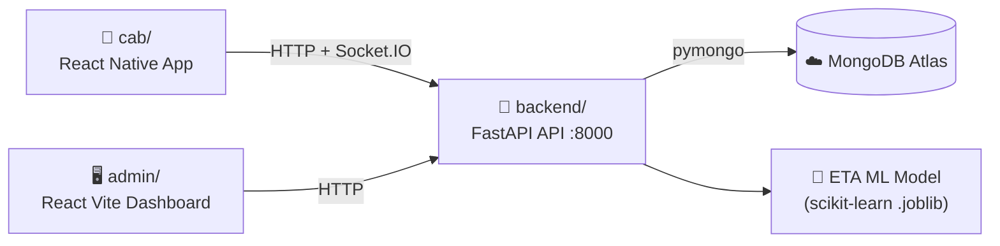

# CabWithAI – Local Setup Guide

> [!IMPORTANT]
> The project is saved at `/Users/ravi/.gemini/antigravity/scratch/cabwithai`

## Project Structure

| Folder | Technology | Purpose |
|--------|-----------|---------|
| `backend/` | Python 3.12 · FastAPI · MongoDB Atlas | REST API + Socket.IO + ML ETA model |
| `admin/` | React 19 · Vite · Tailwind CSS v4 | Admin dashboard (web) |
| `cab/` | React Native 0.87 · TypeScript | Mobile app (rider + driver) |



---

## Step 1 – MongoDB Atlas (Required)

1. Create a free cluster at [cloud.mongodb.com](https://cloud.mongodb.com)
2. Add your machine's IP to **Network Access**
3. Create a DB user with **read/write** access
4. Copy the **connection string** (SRV format)

---

## Step 2 – Backend (FastAPI)

```sh
cd /Users/ravi/.gemini/antigravity/scratch/cabwithai/backend

# Create .env (edit MONGODB_URI, JWT_SECRET, ADMIN_* after)
cp /dev/stdin .env << 'EOF'
MONGODB_URI=mongodb+srv://<user>:<password>@<cluster>.mongodb.net
MONGODB_DATABASE=cabwithai
JWT_SECRET=change_me_to_a_long_random_string
ADMIN_USERNAME=admin
ADMIN_PASSWORD=changeme
OTP_DEV_MODE=true
EOF

# Set up virtual environment
python3 -m venv .venv
source .venv/bin/activate
pip install -r requirements.txt

# Seed admin user
python -m backend.bootstrap_admin

# Start the server
uvicorn backend.main:app --reload --host 0.0.0.0 --port 8000
```

**Verify:** Open [http://127.0.0.1:8000/health](http://127.0.0.1:8000/health) — `database.connected` must be `true`.  
**API docs:** [http://127.0.0.1:8000/docs](http://127.0.0.1:8000/docs)

> [!NOTE]
> `OTP_DEV_MODE=true` means OTPs are printed in the terminal — no SMS provider needed for local testing.

---

## Step 3 – Admin Dashboard (React + Vite)

```sh
cd /Users/ravi/.gemini/antigravity/scratch/cabwithai/admin
pnpm install
pnpm dev
# Opens at http://localhost:5173
```

> [!TIP]
> Uses Tailwind CSS v4 and React 19. No `.env` needed — it calls `localhost:8000` by default.

---

## Step 4 – Mobile App (React Native)

> [!WARNING]
> Requires **Node.js ≥ 22.11** and Android Studio / Xcode.

```sh
cd /Users/ravi/.gemini/antigravity/scratch/cabwithai/cab
node --version   # must be >= 22.11
pnpm install --frozen-lockfile
pnpm start       # Metro bundler

# In a second terminal:
pnpm android     # Android emulator
# or
pnpm ios         # iOS simulator (macOS only, needs pod install)
```

**Physical Android device over USB:**
```sh
adb reverse tcp:8000 tcp:8000
```

---

## Key Config Files

| File | Purpose |
|------|---------|
| [`backend/.env`](file:///Users/ravi/.gemini/antigravity/scratch/cabwithai/backend) | DB URI, JWT secret, admin creds (create from template above) |
| [`cab/src/constants/variable.ts`](file:///Users/ravi/.gemini/antigravity/scratch/cabwithai/cab/src/constants) | API base URL for the mobile app |
| [`backend/models/eta_travel_time.joblib`](file:///Users/ravi/.gemini/antigravity/scratch/cabwithai/backend/models/eta_travel_time.joblib) | Pre-trained ETA model (included in repo) |

---

## Quick Checklist

- [ ] MongoDB Atlas cluster created & IP whitelisted
- [ ] `backend/.env` created with correct `MONGODB_URI` & `JWT_SECRET`
- [ ] Backend running at `:8000` with `database.connected: true`
- [ ] Admin dashboard running at `:5173`
- [ ] Mobile app bundler started (`pnpm start`)
- [ ] Android/iOS emulator launched

---

> [!CAUTION]
> Never commit `.env` files — they are already in `.gitignore` but double-check before any push.
