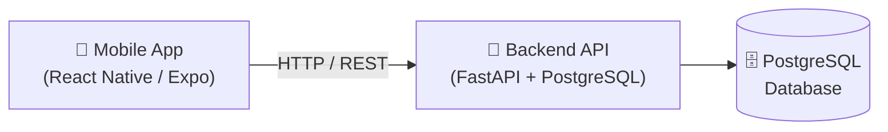
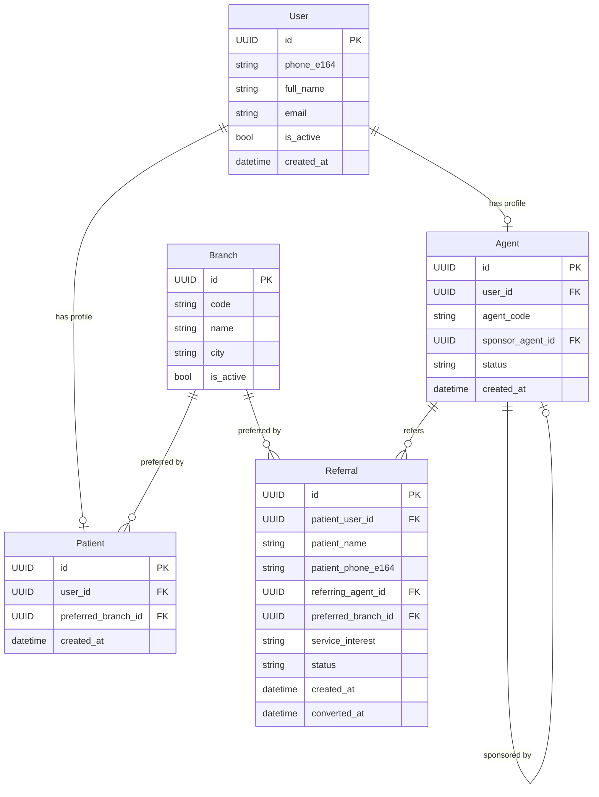

# Kezza Mobile — Project Overview

> [!IMPORTANT]
> Repository successfully cloned to: `/Users/ravi/.gemini/antigravity/scratch/Kezza_mobile`

---

## 🏗️ Project Architecture

Kezza is a **Patient Rewards & Referral Management** platform with two layers:



---

## 📱 Frontend — Expo / React Native

| Property | Value |
|---|---|
| **Framework** | Expo ~57 + React Native 0.86.3 |
| **Language** | TypeScript ~6.0 |
| **Navigation** | Expo Router (file-based) |
| **State Management** | Zustand ^5.1 |
| **Data Fetching** | TanStack React Query ^5.107 + Axios |
| **Forms** | React Hook Form + Zod |
| **Animations** | React Native Reanimated 4.5 + Worklets |
| **Targets** | iOS, Android, Web |

### Key Frontend Files
- [`src/app/_layout.tsx`](file:///Users/ravi/.gemini/antigravity/scratch/Kezza_mobile/src/app/_layout.tsx) — Root layout
- [`src/app/index.tsx`](file:///Users/ravi/.gemini/antigravity/scratch/Kezza_mobile/src/app/index.tsx) — Home screen
- [`src/app/explore.tsx`](file:///Users/ravi/.gemini/antigravity/scratch/Kezza_mobile/src/app/explore.tsx) — Explore screen
- [`src/constants/theme.ts`](file:///Users/ravi/.gemini/antigravity/scratch/Kezza_mobile/src/constants/theme.ts) — Theme/colors
- [`app.json`](file:///Users/ravi/.gemini/antigravity/scratch/Kezza_mobile/app.json) — Expo config (scheme: `kezzamobile`)

---

## 🐍 Backend — FastAPI + PostgreSQL

| Property | Value |
|---|---|
| **Framework** | FastAPI 0.162 |
| **ORM** | SQLAlchemy 2.1 |
| **DB Driver** | psycopg3 (psycopg-binary) |
| **Migrations** | Alembic 1.20 |
| **Validation** | Pydantic v2 |
| **Observability** | OpenTelemetry + Sentry |
| **Server** | Uvicorn + uvloop |

### API Endpoints
| Method | Path | Description |
|---|---|---|
| `GET` | `/` | App info |
| `GET` | `/health` | Health check |
| `GET` | `/health/db` | Database connection check |

### Key Backend Files
- [`backend/app/main.py`](file:///Users/ravi/.gemini/antigravity/scratch/Kezza_mobile/backend/app/main.py) — FastAPI app & routes
- [`backend/app/models.py`](file:///Users/ravi/.gemini/antigravity/scratch/Kezza_mobile/backend/app/models.py) — SQLAlchemy models
- [`backend/app/database.py`](file:///Users/ravi/.gemini/antigravity/scratch/Kezza_mobile/backend/app/database.py) — DB engine setup
- [`backend/requirements.txt`](file:///Users/ravi/.gemini/antigravity/scratch/Kezza_mobile/backend/requirements.txt) — Python dependencies

---

## 🗄️ Database Schema



---

## ⚙️ Environment Setup

### Backend `.env` (create at `backend/.env`)
```env
DB_HOST=localhost
DB_PORT=5432
DB_NAME=kezza_db
DB_USER=your_user
DB_PASSWORD=your_password
```

### Run Backend
```bash
cd /Users/ravi/.gemini/antigravity/scratch/Kezza_mobile/backend
pip install -r requirements.txt
uvicorn app.main:app --reload
```

### Run Frontend
```bash
cd /Users/ravi/.gemini/antigravity/scratch/Kezza_mobile
npm install
npx expo start
```

---

## 📁 Project Structure

```
Kezza_mobile/
├── app.json                    # Expo config
├── package.json                # JS dependencies
├── tsconfig.json
├── src/
│   ├── app/                    # File-based routes (Expo Router)
│   │   ├── _layout.tsx
│   │   ├── index.tsx
│   │   └── explore.tsx
│   ├── components/             # Shared UI components
│   ├── constants/theme.ts      # Design tokens
│   ├── hooks/                  # Custom React hooks
│   └── global.css
├── assets/                     # Images, icons
├── backend/
│   ├── app/
│   │   ├── main.py             # FastAPI entrypoint
│   │   ├── models.py           # DB models
│   │   ├── database.py         # DB connection
│   │   └── base.py             # SQLAlchemy Base
│   ├── migrations/             # Alembic migration files
│   ├── requirements.txt
│   └── alembic.ini
└── scripts/reset-project.js
```
