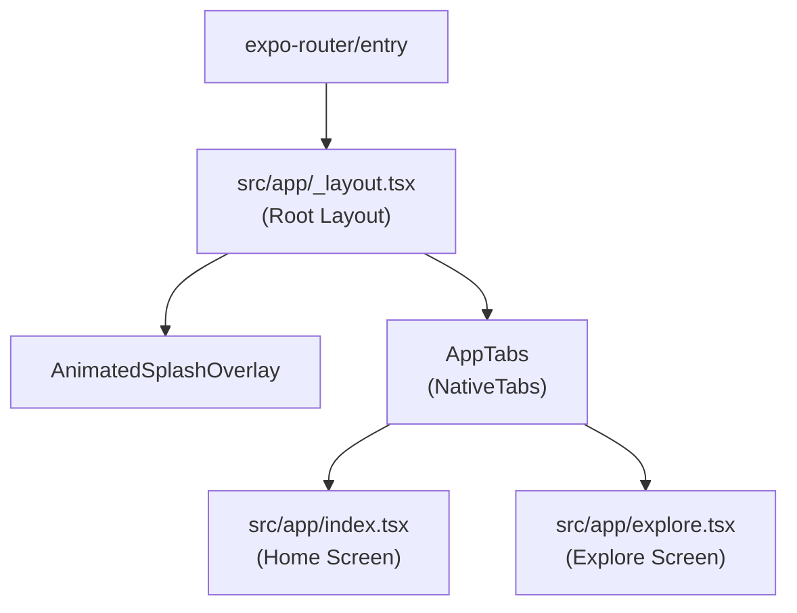
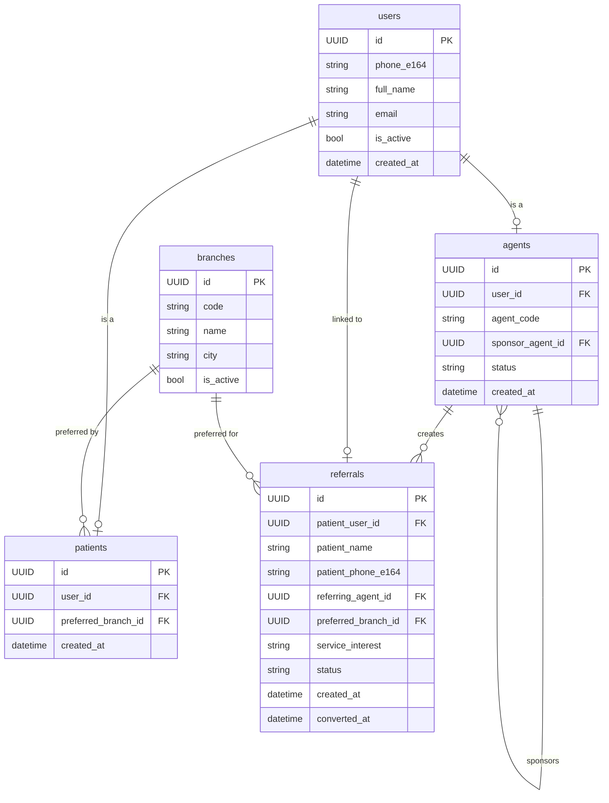

# Kezza Mobile — Codebase Summary

## Project Overview

**Kezza** is a **Patient Rewards & Referral Management** platform consisting of:
- A **React Native / Expo** mobile app (frontend)
- A **FastAPI + PostgreSQL** REST API (backend)

---

## 📱 Frontend — Expo / React Native (`/src`)

### Tech Stack
| Package | Version | Purpose |
|---|---|---|
| Expo SDK | ~57 | Mobile framework |
| React Native | 0.86.3 | Native UI |
| Expo Router | ~57 | File-based navigation |
| React Query (`@tanstack/react-query`) | ^5 | Server state management |
| Zustand | ^5 | Client state management |
| React Hook Form + Zod | ^7 / ^4 | Forms & validation |
| Axios | ^1.21 | HTTP client |
| React Native Reanimated | 4.5.1 | Animations |
| Expo Secure Store | ~57 | Secure token storage |

### App Architecture



### Screens

#### `src/app/_layout.tsx` — Root Layout
- Wraps the app in Expo Router's `ThemeProvider` (light/dark mode).
- Renders `AnimatedSplashOverlay` before showing content.
- Mounts the `AppTabs` navigator.

#### `src/app/index.tsx` — Home Screen
- Shows an animated Expo logo icon, a welcome title, and a card of developer hint rows.
- Hints show how to edit the entry file, open the dev menu, and reset the project.
- Shows a `WebBadge` on web platform.

#### `src/app/explore.tsx` — Explore Screen
- A scrollable screen with Expo documentation shortcuts.
- Contains collapsible sections covering: file-based routing, platform support, images, light/dark mode, and animations.
- Uses `ExternalLink` to open the Expo docs in an in-app browser.

---

### Components (`src/components/`)

| File | Description |
|---|---|
| `animated-icon.tsx` | **AnimatedSplashOverlay** — full-screen splash that fades out after `SplashScreen.hideAsync()`. **AnimatedIcon** — spinning glow + zoom-in logo animation using Reanimated `Keyframe`. |
| `animated-icon.web.tsx` | Web-specific variant of the animated icon. |
| `app-tabs.tsx` | Native tab bar using `expo-router/unstable-native-tabs` with **Home** and **Explore** tabs. Colors adapt to light/dark scheme. |
| `app-tabs.web.tsx` | Web-specific tab bar variant. |
| `themed-text.tsx` | `ThemedText` — text component with 8 type variants (`default`, `title`, `small`, `smallBold`, `subtitle`, `link`, `linkPrimary`, `code`) and automatic theme-aware coloring. |
| `themed-view.tsx` | `ThemedView` — `View` wrapper that applies theme background colors automatically. |
| `hint-row.tsx` | `HintRow` — a two-column row (label + code snippet chip) used on the Home screen. |
| `external-link.tsx` | `ExternalLink` — opens URLs in-app via `expo-web-browser` on native, falls back to `target="_blank"` on web. |
| `ui/collapsible.tsx` | `Collapsible` — accordion component with animated chevron icon and `FadeIn` reveal animation. |
| `web-badge.tsx` | `WebBadge` — displays the current Expo SDK version and the Expo badge logo; only shown on web. |

### Constants & Hooks (`src/constants/`, `src/hooks/`)

| File | Description |
|---|---|
| `constants/theme.ts` | Defines `Colors` (light/dark palettes), `Fonts` (platform-specific font families), `Spacing` scale (2–64 pt), `BottomTabInset`, and `MaxContentWidth`. |
| `hooks/use-theme.ts` | `useTheme()` — returns the correct color palette based on the active color scheme. |
| `hooks/use-color-scheme.ts` | Wraps `useColorScheme` from React Native. |
| `hooks/use-color-scheme.web.ts` | Web-specific color scheme hook. |
| `global.css` | Global CSS imported for web builds. |

---

## 🔧 Backend — FastAPI + PostgreSQL (`/backend`)

### Tech Stack
| Package | Version | Purpose |
|---|---|---|
| FastAPI | 0.162.4 | REST API framework |
| SQLAlchemy | 2.1.8 | ORM |
| Alembic | 1.20.1 | Database migrations |
| Psycopg (v3) | 3.3.8 | PostgreSQL driver |
| Pydantic v2 | 2.14.3 | Data validation |
| Uvicorn | 0.54.0 | ASGI server |
| python-dotenv | 1.2.4 | Environment config |

### API (`backend/app/main.py`)

| Endpoint | Method | Description |
|---|---|---|
| `/` | GET | App info (name, version) |
| `/health` | GET | Liveness check |
| `/health/db` | GET | DB connectivity check (returns current database & user) |

> [!NOTE]
> The API is currently in its foundational phase — only health/info endpoints are implemented. Business logic (referral management, rewards, auth) is yet to be built.

### Database Layer

#### `backend/app/database.py`
- Reads `DB_HOST`, `DB_PORT`, `DB_NAME`, `DB_USER`, `DB_PASSWORD` from `.env`.
- Builds a `postgresql+psycopg` SQLAlchemy engine with `pool_pre_ping=True` and a 5 s connection timeout.
- Raises `RuntimeError` at startup if any env variable is missing.

#### `backend/app/base.py`
- Defines `Base(DeclarativeBase)` — the SQLAlchemy ORM base class.

### Data Models (`backend/app/models.py`)



| Model | Key Fields | Notes |
|---|---|---|
| `User` | `phone_e164` (unique), `full_name`, `email`, `is_active` | Base account for all users |
| `Branch` | `code` (unique), `name`, `city`, `is_active` | Clinic locations |
| `Patient` | FK → `User`, FK → `Branch` | Patient profile linked to a user account |
| `Agent` | `agent_code` (unique), `sponsor_agent_id` (self-referential FK), `status` | Referral agents with MLM-style sponsor chain; status ∈ `{pending_verification, active, inactive, suspended}` |
| `Referral` | `patient_user_id` (nullable), `patient_name`, `referring_agent_id`, `status` | Tracks patient leads; `patient_user_id` is nullable so agents can register leads before the patient has an account; status ∈ `{registered, contacted, consultation_booked, converted, not_converted, rejected}` |

### Migrations (`backend/migrations/`)
- Managed by **Alembic**.
- Single migration `643252b8f44a` creates all 5 initial tables (`branches`, `users`, `agents`, `patients`, `referrals`) with indexes on `agents.sponsor_agent_id` and `(referrals.referring_agent_id, status)`.

---

## 🗂️ Project Structure Summary

```
Kezza_mobile-main/
├── src/                        # Expo/React Native app
│   ├── app/                    # Expo Router screens
│   │   ├── _layout.tsx         # Root layout (ThemeProvider + tabs)
│   │   ├── index.tsx           # Home screen
│   │   └── explore.tsx         # Explore/docs screen
│   ├── components/             # Reusable UI components
│   ├── constants/theme.ts      # Colors, fonts, spacing
│   └── hooks/                  # useTheme, useColorScheme
├── backend/                    # FastAPI backend
│   ├── app/
│   │   ├── main.py             # FastAPI app + health endpoints
│   │   ├── models.py           # SQLAlchemy ORM models
│   │   ├── database.py         # DB engine setup
│   │   └── base.py             # DeclarativeBase
│   ├── migrations/             # Alembic migration scripts
│   └── requirements.txt        # Python dependencies
├── package.json                # JS dependencies & scripts
└── tsconfig.json               # TypeScript config
```

---

## Current State

> [!IMPORTANT]
> The project is in **early scaffolding stage**:
> - The **mobile app** uses the default Expo Router template — no Kezza-specific screens, auth, or business logic yet.
> - The **backend** has the data models and DB schema but **no API routes** for auth, referrals, rewards, or patient management yet.
> - The domain model is well-designed: Users → Patients/Agents, clinic Branches, referral tracking with a full status lifecycle.
