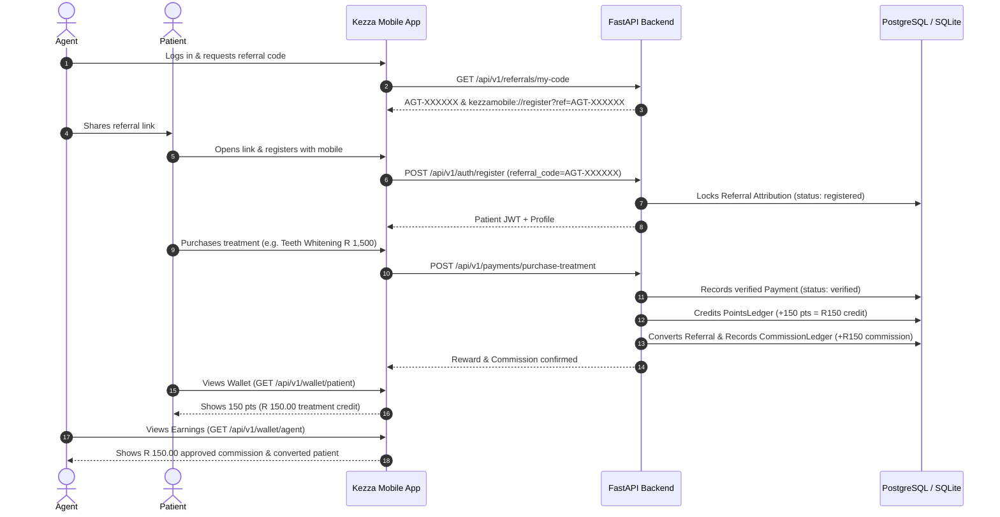

# Kezza — Development Roadmap & MVP Journey

> Status: **End-to-End MVP Journey Complete & Tested** (2026-11-13)

---

## 🏆 First End-to-End MVP Journey — COMPLETED & TESTED ✅

The complete business cycle from agent referral link to rewards and commission payout is fully implemented and tested across backend and mobile frontend:

---

## Roadmap Phases Status

### Phase 1 — Stabilize the Foundation ✅ COMPLETE
- [x] Initialized Git repository and confirmed `.env` is git-ignored
- [x] Verified existing migration (`643252b8f44a`) and database models
- [x] Refactored backend into modern modular package structure
- [x] Implemented `SessionLocal` factory and `get_db` FastAPI dependency
- [x] Added automated smoke tests (`test_health.py`)

### Phase 2 — Complete Database Models ✅ COMPLETE
- [x] Added `Payment` model with payment references and verification status
- [x] Added `PointsLedger` model with earn/redeem event types and running balance
- [x] Added `CommissionTier` and `CommissionLedger` models
- [x] Added `OtpRequest` model
- [x] Created Alembic migration `a89c31bdf721_create_payments_points_commission_tables.py`

### Phase 3 — Authentication & User Management ✅ COMPLETE (MVP Journey)
- [x] Mobile number OTP request (`POST /api/v1/auth/otp/request`)
- [x] OTP verification (`POST /api/v1/auth/otp/verify`)
- [x] Patient & Agent registration with role detection (`POST /api/v1/auth/register`)
- [x] JWT token generation and authentication middleware (`get_current_user`)
- [x] Mobile screen integration: `login.tsx` & `verify-otp.tsx` with role selection

### Phase 4 — Referral Management ✅ COMPLETE (MVP Journey)
- [x] Unique agent referral code generation (e.g. `AGT-XXXXXX`)
- [x] Shareable referral link (`kezzamobile://register?ref=AGT-XXXXXX`)
- [x] Automatic referral attribution locking upon patient registration
- [x] Duplicate referral prevention (checked by mobile phone number)
- [x] Agent referral pipeline tracking (`registered` → `converted`)
- [x] Mobile screen integration: `referrals.tsx` with lead creation & pipeline list

### Phase 5 — Patient Points & Wallet ✅ COMPLETE (MVP Journey)
- [x] Verified payment processing (`POST /api/v1/payments/purchase-treatment`)
- [x] Automatic points calculation (1 point per R10 spent = 10% back)
- [x] Points ledger recording with balance tracking
- [x] Patient treatment credit wallet (`GET /api/v1/wallet/patient`)
- [x] Mobile screen integration: `wallet.tsx` with live ledger and credit card

### Phase 6 — Agent Network & Commissions ✅ COMPLETE (MVP Journey)
- [x] Automatic commission calculation on verified referred sales (10% tier)
- [x] Commission ledger tracking (`approved`, `pending`, `paid`)
- [x] Conversion marking on referring agent's pipeline
- [x] Agent earnings dashboard (`GET /api/v1/wallet/agent`)
- [x] Mobile screen integration: `wallet.tsx` with earnings breakdown & ledger

### Phase 7 — Mobile UI Integration ✅ COMPLETE (MVP Journey)
- [x] 3 core tabs: **Home**, **Referrals**, **Wallet** with custom icons and role awareness
- [x] Profile screen with user information and role-switching demo helper
- [x] Interactive treatment purchase simulator on the Home screen to test the live loop
- [x] One-tap link copying (`expo-clipboard`) for referral sharing

### Phase 8 — Production Readiness 🔲 NEXT
- [ ] Admin management portal
- [ ] Real SMS gateway integration (Twilio / Africa's Talking)
- [ ] Clinic POS / PMS billing system webhook integration
- [ ] Push notifications (Expo Notifications)
- [ ] Cloud deployment & automated CI/CD pipeline
